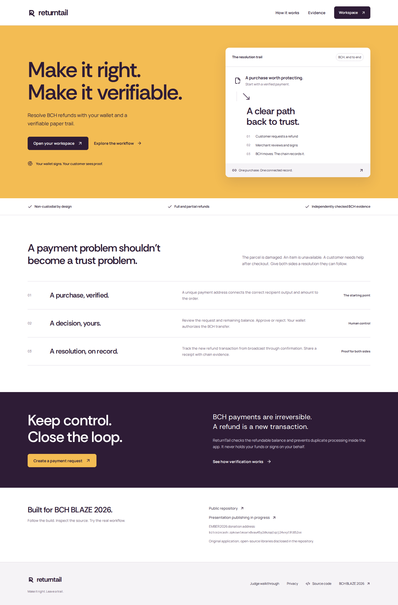
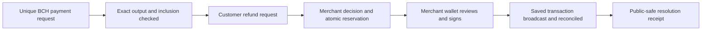

# ReturnTail

**Make it right. Make it verifiable.**

ReturnTail connects a Bitcoin Cash purchase to a customer’s refund request, a merchant’s decision, a wallet-authorized refund transaction, and a shareable record of what happened. BCH goes directly between wallets: ReturnTail does not custody funds or hold spending keys.

[Live app](https://returntail.vercel.app) · [Judge walkthrough](https://returntail.vercel.app/guide) · [Break It Lab](https://returntail.vercel.app/lab) · [Public mainnet receipt](https://returntail.vercel.app/resolution/6c5fb204-f24e-4fa1-b944-d4ff710ecb02) · [Evidence page](https://returntail.vercel.app/evidence) · [Source](https://github.com/sopskistar/returntail)

> **For judges:** the walkthrough and Break It Lab require no wallet connection or payment. They are a guided explanation and read-only hosted security probes; neither creates a transaction. The real mainnet self-test and its independent transaction links are documented below.



*Hosted ReturnTail interface. The purchase-to-refund journey shown in the hero is a product explanation; the independently checked transaction evidence is in the public receipt below.*

## The problem after checkout

BCH settles directly and irreversibly. When an order needs a partial refund, the merchant and customer otherwise have to reconnect a payment, a reason, a decision, a destination, and a new wallet transfer across messages and spreadsheets. A merchant can also accidentally approve more than the original purchase amount when several requests arrive together.

## One connected resolution record

ReturnTail assigns a fresh receiving address to each payment request, checks the exact BCH output, and allows the customer holding that request’s private capability to ask for a refund. The merchant reviews each request and approves or rejects it. Approval reserves the amount in the app’s accounting; the merchant then reviews and signs a **new** BCH transaction in their wallet. ReturnTail validates the signed transaction, records its identity before broadcast, and tracks network observation separately from confirmation.



The merchant’s approval and the chain’s transaction inclusion answer different questions. The receipt keeps those application records distinct from transaction and block facts.

## A real BCH mainnet self-test

The following transactions are independently cross-checked against Selene Explorer and Blockchair. The application receipt links them as one confirmed resolution. Wallet names and the excessive-refund decision are application/user-reported context, not facts that a blockchain explorer can establish.

| Event | Verified chain details | Explorer records |
| --- | --- | --- |
| Customer payment | **10,000 sats**, output `vout 0`; block `978327`; block hash `0000000000000000002aa13e287c2ac732a0f45edfd1897ce63b610cc9940e70`; 28 confirmations at provider tip `978354` (November 21, 2026 snapshot). | [Selene](https://explorer.selene.cash/tx/2ea6fecd4d77ad7af9bbd69038eb0c76f1d8a536835041828da0298189b51c65?network=mainnet) · [Blockchair](https://blockchair.com/bitcoin-cash/transaction/2ea6fecd4d77ad7af9bbd69038eb0c76f1d8a536835041828da0298189b51c65) |
| Merchant-authorized refund | **4,000 sats**, output `vout 0`; spent the original payment’s `vout 0`; 454-sat fee; 5,546-sat second output; block `978337`; block hash `000000000000000001a1fd253dac1529f3de6e130440f5678a79ead87cd2d172`; 18 confirmations at provider tip `978354` (November 21, 2026 snapshot). | [Selene](https://explorer.selene.cash/tx/c4ce3d46aa2f14c81a9a6fb8b12dcde6e8e9678539f1e20d060073cce670b85b?network=mainnet) · [Blockchair](https://blockchair.com/bitcoin-cash/transaction/c4ce3d46aa2f14c81a9a6fb8b12dcde6e8e9678539f1e20d060073cce670b85b) |

The purchase hash is **`2ea6fecd…`**. An earlier transcription in the project ledger used **`2ea6feed…`** (one character differs) and returned not found. The corrected hash above is the one present in both providers and the public receipt. Confirmation counts are a dated observation, not a current finality guarantee; the explorers show the current chain state when opened.

The [public-safe resolution receipt](https://returntail.vercel.app/resolution/6c5fb204-f24e-4fa1-b944-d4ff710ecb02) is refund record **`6c5fb204-f24e-4fa1-b944-d4ff710ecb02`**, reference `RT-D992C0E1`, state `confirmed`. Its unauthenticated API response links the two txids and confirms the purchase/refund amounts and recorded inclusion checks. It omits customer destination, reason, email, access capability, session details, and raw transaction bytes.

The user reports using Selene for the 10,000-sat payment and Paytaca to authorize the 4,000-sat refund. The user also reports that a 7,000-sat request was refused because the 4,000-sat refund had reserved the available balance, and was then rejected. The merchant’s private audit rows for those decisions were not independently retrieved in this session. ReturnTail’s public receipt does not prove that 7,000-sat decision. See the [evidence ledger](docs/MAINNET_PROOF.md) for the sources, timestamps, discrepancy, and remaining application-record check.

`/evidence` can feature this receipt when the existing Vercel project has `PUBLIC_PROOF_REFUND_ID` set to the verified **refund database UUID** above. It is not the txid. Until that setting is added and the deployment is checked, use the direct receipt URL above.

## A no-payment judge walkthrough

1. Open the [live app](https://returntail.vercel.app) and select **Explore the workflow** or open the [judge walkthrough](https://returntail.vercel.app/guide). Follow the six stages; do not create a payment request or connect a wallet.
2. Open [Break It Lab](https://returntail.vercel.app/lab). Run **Public service readiness**, **Private merchant workspace**, and **Private purchase access**. The probes use credential-free `GET` requests and show expected readiness/authentication responses. They make no financial writes.
3. In the same page, inspect the links to the isolated PostgreSQL refund tests and BCH transaction validation tests. Those tests use fixtures and do not reproduce the physical-wallet transactions.
4. Open the [public receipt](https://returntail.vercel.app/resolution/6c5fb204-f24e-4fa1-b944-d4ff710ecb02), then follow its two explorer links. Compare transaction IDs, outputs, block heights and hashes. No account is required.

Do not submit a wallet signature or send BCH during judging. The receipt and explorers demonstrate the completed test; the walkthrough and lab demonstrate product flows and access controls without funds.

## What each piece does

| Component | Role in ReturnTail |
| --- | --- |
| **Bitcoin Cash** | Direct merchant payments and new, merchant-authorized refund transactions. A refund is not a reversal of the purchase. |
| **WizardConnect** | Connects the browser to the wallet for address discovery and explicit transaction signing. A pairing or public key alone does not establish ownership. |
| **Paytaca** | Merchant wallet used for the reported signing and refund in this real self-test. |
| **Selene** | Customer wallet reported for the original payment and the customer’s refund destination. |
| **PostgreSQL / Neon** | Stores merchant sessions, purchase/refund records, idempotency, audit history, input reservations, and settlement state. The server never stores a seed phrase or spending key. |
| **Independent BCH providers** | Supply transaction and block observations; ReturnTail checks transaction identity, exact outputs, merkle inclusion, and a witness provider. It is provider-assisted verification, not a full proof-of-work node. |

## Financial safeguards

- Amounts are integer satoshis; the selected recipient output must exactly match the reviewed amount and BCH script.
- PostgreSQL row locks and conditional balance updates serialize refund decisions. The cumulative reserved plus settled amount cannot exceed the confirmed purchase amount.
- Signed transaction bytes and their computed txid are durably saved before broadcast. Unknown outcomes keep reservations; recovery reconciles and can only rebroadcast the same bytes.
- The unsigned plan fixes recipient, source inputs, fee budget, and change destination. Returned signatures are parsed, checked for unchanged intent, and validated by the BCH script VM with the required sighash flags.
- Database uniqueness and idempotency protect payment outputs, settlement identities, input reservations, and repeated requests. Merchant authorization is checked before idempotent results are returned.
- Cancelled payment requests remain in history, their receiving destinations are retired, and late activity is retained for manual review.
- A merchant’s xpub is public derivation material, **not ownership proof**. The application cannot prevent the merchant from making additional transfers outside ReturnTail.

More detail: [architecture](docs/ARCHITECTURE.md), [security tests](docs/SECURITY_TESTS.md), and the [cancellation safety design](docs/PAYMENT_REQUEST_CANCELLATION.md).

## Architecture

Next.js App Router and TypeScript expose JSON API routes with Zod input validation. The server uses parameterized PostgreSQL transactions for authentication, idempotency and financial state transitions. `src/core/bch.ts` constructs BCH plans and validates signed bytes; `src/server/chain.ts` speaks to TLS-verified Fulcrum-compatible providers, checks network checkpoints and observes transaction inclusion. WizardConnect keeps wallet signing in the browser and returns signed bytes; the server has no spending keys.

```text
Browser + WizardConnect ──review/sign──> customer or merchant wallet
        │                                      │
        │ JSON API                             └── signed BCH transaction
        ▼                                                 │
Next.js server ──atomic records──> PostgreSQL             ├── broadcast
        │                                                 └── providers verify
        └── public-safe resolution receipt <─────────────────┘
```

See [architecture notes](docs/ARCHITECTURE.md) for the transaction state machine, chain-provider limits, and database entities.

## Run locally

Requirements: Node.js **22.13+**, npm, and PostgreSQL 17 (or a compatible local PostgreSQL/Neon test instance). The default network is Chipnet. Never put a real spending key or recovery phrase in ReturnTail.

```sh
git clone https://github.com/sopskistar/returntail.git
cd returntail
npm ci
cp .env.example .env.local
```

Set `DATABASE_URL` to an isolated local database and set a random `AUTH_SECRET` of at least 32 characters in `.env.local`. Do not point integration tests at production Neon. Then:

```sh
npm run db:migrate
npm run dev
```

Open `http://localhost:3000`. For the full validation suite, configure an isolated `RETURNTAIL_TEST_DATABASE_URL` and run:

```sh
npm run typecheck
npm run lint
npm test
npm run test:integration
npm run build
npm run test:e2e
npm run scan:secrets
npm audit --audit-level=high
```

Browser tests target localhost and may use clearly labeled fixtures. They do not sign or broadcast real BCH. See [deployment notes](docs/DEPLOYMENT.md) and [.env.example](.env.example) before configuring a local environment.

## Project links and release materials

- **Live app:** [returntail.vercel.app](https://returntail.vercel.app)
- **Judge walkthrough:** [returntail.vercel.app/guide](https://returntail.vercel.app/guide)
- **Break It Lab:** [returntail.vercel.app/lab](https://returntail.vercel.app/lab)
- **Public mainnet receipt:** [confirmed resolution](https://returntail.vercel.app/resolution/6c5fb204-f24e-4fa1-b944-d4ff710ecb02)
- **Evidence index:** [/evidence](https://returntail.vercel.app/evidence) (set `PUBLIC_PROOF_REFUND_ID=6c5fb204-f24e-4fa1-b944-d4ff710ecb02` in the existing Vercel project to feature the receipt there)
- **Widget Factory presentation:** add the URL of the existing published deck through `WIDGET_FACTORY_URL`; the deck has not been replaced or recreated.
- **Demo video:** final public video link pending. Use the [scene-by-scene recording plan](docs/VIDEO_SCRIPT.md); the existing 45-second engineering preview is not the final hackathon demo.

## Scope, provenance, and licenses

The current release supports one store per account, standard P2PKH BCH, bounded receiving-address discovery, and daily scheduled reconciliation plus user-triggered refresh. It has no email verification or password recovery. Provider-assisted merkle/header checks depend on public infrastructure and are not a full node. Connection to a wallet or matching an advertised chain does not by itself prove control of every derived address.

The BCH BLAZE submission uses a self-test, not an external customer case. The earliest commit in this repository is dated November 17, 2026; that Git history does not establish when all prior work began. Disclose any earlier prototypes and changes accurately in the [submission checklist](docs/SUBMISSION.md). The app is MIT-licensed; WizardConnect is LGPL-3.0-or-later, and bundled fonts are OFL. See [third-party notices](THIRD_PARTY_NOTICES.md).

AI tools assisted with implementation, code review, and documentation, including this release README. Automated fixture results are labeled as tests and are not presented as real-world customer performance.
